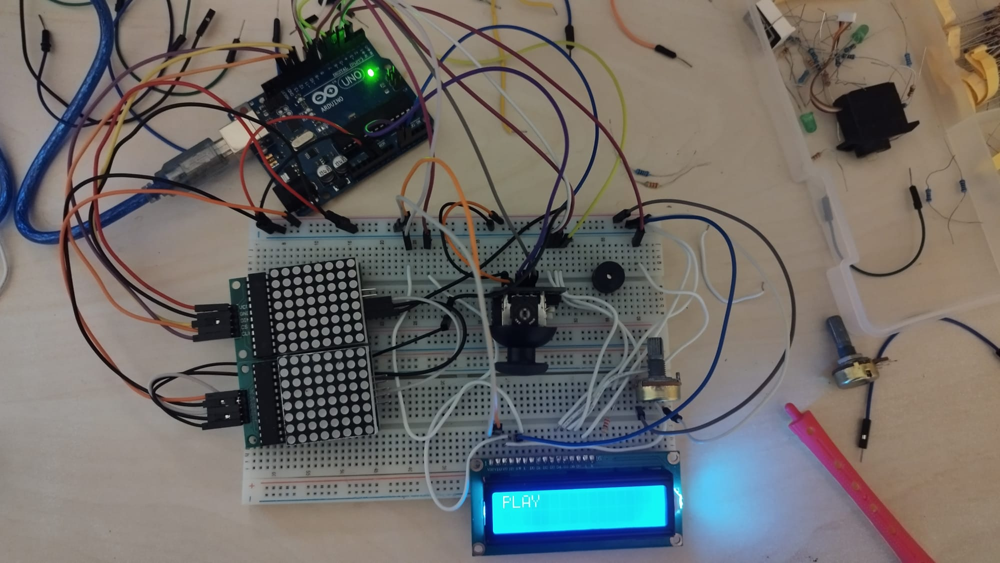
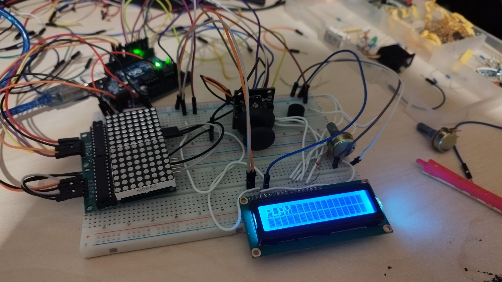

# MatrixTetrisProject
A tetris game made on 2 8 by 8 LED matrices with Arduino Uno

## Checkpoint 1

### Hardware used:

1. 2 Matrices
2. 2 Matrix modules for easy daisy chaining
3. Joystick
4. LCD

### Functionalities implemented:

1. Menu scroll
2. The game itself (TETRIS)
3. Highscores

### To be implemented:

1. Name input and uses
2. All settings
3. During gameplay: button to save a piece and show it on LCD
4. During gameplay: show next piece
5. Game startup screen
6. Buzzer sounds

#### Setup:

#### [Video of project implementation](https://youtu.be/0INSKQgpBus)